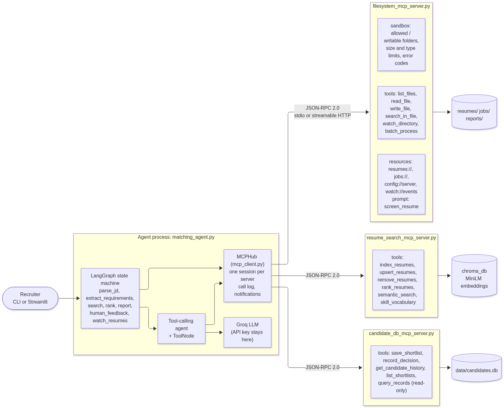
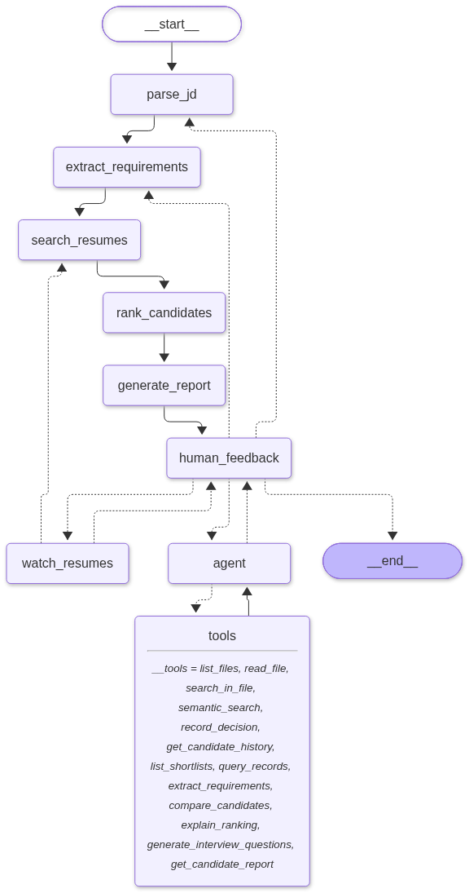
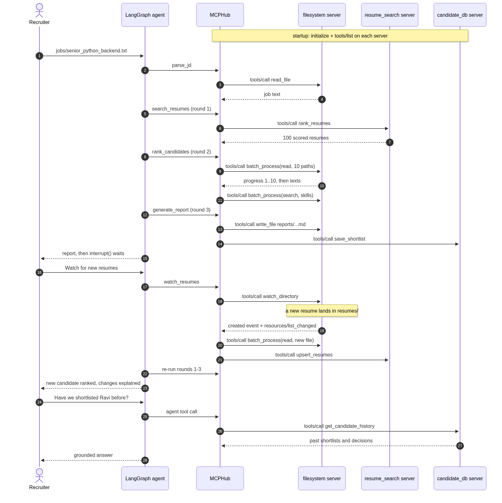

# MCP Profile Matching (Milestone 4: MCP integration)

The Milestone 3 LangGraph recruiting agent, rebuilt so it reaches files, the resume index, and hiring history only through **Model Context Protocol servers**. The Milestone 1 file tools now live in `filesystem_mcp_server.py`. Two more MCP servers (vector search and a SQLite candidate database) complete the bonus multi-MCP setup.

| | Milestone 3 | Milestone 4 (this project) |
|---|---|---|
| File access | `agent_tools.py` imported `fs_tools` and opened files directly | `filesystem_mcp_server.py`, reached over JSON-RPC 2.0 |
| Resume index | Chroma opened inside the agent process | `resume_search_mcp_server.py` (owns Chroma and the embedding model) |
| Hiring history | none | `candidate_db_mcp_server.py` (SQLite) |
| Tool definitions | hand-written LangChain wrappers | discovered at startup with `tools/list`, using each server's own JSON schema |
| New capabilities | none | `watch_directory()`, `batch_process()`, resources, prompts, discovery, config, error codes |

## Architecture



`mcp_client.py` (`MCPHub`) keeps one long-lived MCP session per server inside a background asyncio loop. The LangGraph nodes, the tool-calling agent, the CLI, Streamlit, and the tests all call `hub.call_tool(server, tool, args)`. Every call is logged with server, tool, duration, and outcome, and the CLI prints these as `[mcp]` lines in the agent's reasoning trace.

### Agent state machine



Generated from the compiled graph by `python draw_graph.py`. Compared with Milestone 3 there is a new `watch_resumes` node: "watch for new resumes" calls `watch_directory`, indexes whatever arrives, and re-runs the three screening rounds.

### Agent and MCP interaction



Sources for both diagrams are in `docs/*.mmd`.

## Part A: `filesystem_mcp_server.py`

Built on the official MCP Python SDK (`mcp` 2.3, `MCPServer`), so the transport, the `initialize` handshake, and JSON-RPC 2.0 framing follow the specification. It runs on stdio (how the agent launches it) or streamable HTTP (`--transport http`).

**Tools**

| Tool | Purpose |
|---|---|
| `list_files(directory, extension?)` | Milestone 1 tool: files in an allowed folder with size and modified time |
| `read_file(filepath)` | Milestone 1 tool: text of a `.pdf`, `.txt`, or `.docx` resume or job description |
| `write_file(filepath, content)` | Milestone 1 tool: write `.md`, `.txt`, or `.json` inside a writable folder (`reports/`) |
| `search_in_file(filepath, keyword)` | Milestone 1 tool: matching lines with one line of context |
| `watch_directory(directory, timeout_seconds, since_event_id?)` | **New.** Waits for created, modified, or deleted resumes and returns the events plus `last_event_id`, so the next call continues where this one stopped. Sends progress notifications while waiting and `notifications/resources/list_changed` when new resumes appear. |
| `batch_process(operation, paths? \| directory?, keywords?, ...)` | **New.** `read`, `metadata`, `search`, or `summary` over many files on a thread pool, with progress notifications. One bad file does not fail the batch: every item has `success` plus `data` or an `error` with a code. |

`watch_directory` polls on a background thread instead of using OS file events, which behaves the same on Windows, macOS, Linux, and Docker bind mounts (which do not forward inotify). A file is reported only after its size and timestamp hold steady for one poll, so a resume that is still being copied is not read half-written.

**Resources, prompts, and discovery**

| URI or name | Content |
|---|---|
| `resumes://index`, `jobs://index` | JSON listing of resumes or job descriptions |
| `resumes://{filename}`, `jobs://{filename}` | Text of one file (resource templates) |
| `config://server` | Effective configuration, including the error-code table |
| `watch://events` | Recent change events from the watcher |
| prompt `screen_resume(resume_file, job_file)` | Reusable screening prompt that points at the two resources |

Standard MCP discovery works out of the box: `tools/list`, `resources/list`, `resources/templates/list`, and `prompts/list`. Over HTTP each server also exposes `GET /health` and `GET /discovery` (server info, tools, resources, templates, prompts, config) next to the `/mcp` endpoint.

**Error handling and status codes**

Following the specification, a failure while running a tool comes back as a normal result with `isError: true`, so the model can read it and recover. Failures in protocol methods such as `resources/read` are JSON-RPC error responses. Both carry the same numeric codes from `mcp_errors.py`:

| Code | Name | When |
|---|---|---|
| -32700 / -32600 / -32601 / -32602 / -32603 | JSON-RPC standard codes | Malformed JSON, invalid request, unknown method, invalid params, internal error |
| -32001 | `FILE_NOT_FOUND` | Missing file or folder |
| -32002 | `ACCESS_DENIED` | Path outside the allowed folders, including `../` tricks and absolute paths |
| -32003 | `UNSUPPORTED_TYPE` | File type not allowed for reading or writing |
| -32004 | `FILE_TOO_LARGE` | Above `max_file_size_mb` |
| -32005 | `NOT_A_RESUME` | Readable file without resume sections |
| -32006 | `BATCH_LIMIT_EXCEEDED` | More files than `max_batch_size` |
| -32007 | `WRITE_DENIED` | Writing outside `writable_directories` |
| -32009 | `READ_FAILED` | Could not extract text |
| -32010 / -32011 | `NOT_FOUND` / `INDEX_EMPTY` | Used by the bonus servers |

A raw exchange, exactly as it appears on the wire:

```text
--> {"jsonrpc":"2.0","id":8,"method":"tools/call","params":{"name":"read_file","arguments":{"filepath":"dataset.py"}}}
<-- {"jsonrpc":"2.0","id":8,"result":{"content":[{"type":"text","text":"Error executing tool read_file: {\"error\": {\"code\": -32002, \"name\": \"ACCESS_DENIED\", ...}}"}],"isError":true}}
--> {"jsonrpc":"2.0","id":9,"method":"resources/read","params":{"uri":"resumes://does_not_exist.txt"}}
<-- {"jsonrpc":"2.0","id":9,"error":{"code":-32001,"message":"File not found: resumes/does_not_exist.txt","data":{"path":"resumes/does_not_exist.txt","name":"FILE_NOT_FOUND"}}}
```

**Configuration management**

`mcp_config.json` holds allowed and writable folders, file types, size and batch limits, worker threads, watch interval and maximum wait, transport, ports, and log level. `mcp_settings.py` validates it with pydantic and applies environment overrides, so the same code runs locally, in tests, and in Docker without edits: `MCP_CONFIG`, `MCP_TRANSPORT`, `MCP_HOST`, `MCP_LOG_LEVEL`, `MCP_FS_ALLOWED_DIRS`, `MCP_FS_WRITABLE_DIRS`, `MCP_FS_MAX_FILE_MB`, `MCP_BATCH_MAX_WORKERS`, `MCP_<SERVER>_URL`, `MCP_ALLOWED_HOSTS`. Logs go to `logs/<server>.log`. On stdio, stdout is reserved for JSON-RPC.

## Part B: refactored `matching_agent.py`

- **No direct file-system tools remain.** `agent_tools.py`, `screening.py`, and `matching_agent.py` do not import `fs_tools`, `chromadb`, or `sqlite3`, and they open no files.
- **Same functionality.** Job files are read with `filesystem.read_file`. Round 1 scores resumes with `resume_search.rank_resumes`. Round 2 reads all 10 shortlisted resumes with one `filesystem.batch_process(read)` and collects evidence with one `batch_process(search)`. Reports are written with `filesystem.write_file` and recorded with `candidate_db.save_shortlist`. All Milestone 3 conversation flows still pass.
- **Cleaner tool layer.** The agent's MCP tools come from `tools/list` at startup. `MCPHub.langchain_tools()` wraps each one with the server's own `inputSchema`, so tool definitions live in exactly one place: the server. The five screening tools (compare, explain, interview questions, candidate report, extract requirements) stay as agent-side logic, but every file and index access they make goes through MCP.
- **Least privilege.** Servers only receive `MCP_*`, `HF_*`, and a few Python settings from the environment. The Groq API key stays in the agent process.
- **Indexing through MCP.** `python ingest.py` runs `filesystem.batch_process(read, directory="resumes")`, then `resume_search.index_resumes(...)`.

## Bonus: multi-MCP integration

| Server | Tools | Resources |
|---|---|---|
| `resume_search_mcp_server.py` | `index_resumes`, `upsert_resumes`, `remove_resumes`, `rank_resumes`, `semantic_search`, `skill_vocabulary`, `index_stats` | `index://stats`, `index://resumes` |
| `candidate_db_mcp_server.py` | `save_shortlist`, `record_decision`, `get_candidate_history`, `list_shortlists`, `query_records` (single read-only SELECT on a `mode=ro` connection) | `db://schema`, `db://shortlists/recent` |

In one conversation the agent uses all three servers. It screens with filesystem plus resume_search, picks up a newly dropped resume (filesystem `watch_directory`, then resume_search `upsert_resumes`, then re-ranking), answers "have we shortlisted X before?" from candidate_db, records a decision, and answers open questions such as "who has Kafka experience?" with `semantic_search`.

## Setup

Python 3.10 or newer (built with 3.11).

```bash
git clone https://github.com/Nagaraj172004/mcp-profile-matching.git
cd mcp-profile-matching
```

Windows (PowerShell):

```powershell
py -3.11 -m venv .venv
.\.venv\Scripts\Activate.ps1
python -m pip install --upgrade pip
pip install -r requirements.txt
copy .env.example .env
```

In Command Prompt, activate with `.venv\Scripts\activate.bat` instead.

macOS / Linux:

```bash
python3.11 -m venv .venv
source .venv/bin/activate
python -m pip install --upgrade pip
pip install -r requirements.txt
cp .env.example .env
```

Then put your Groq key in `.env` ([console.groq.com/keys](https://console.groq.com/keys)) and build the index through MCP:

```bash
python ingest.py            # filesystem.batch_process -> resume_search.index_resumes
python draw_graph.py        # optional: regenerate docs/*.png
```

The resumes and job descriptions are already in the repo. `python generate_resumes.py` regenerates them from `dataset.py`.

**HTTPS certificates.** Certificate verification stays on everywhere. `tls.py` uses [truststore](https://pypi.org/project/truststore/) so Python checks certificates against the operating system's trust store, which also covers networks that inspect HTTPS. Old pip versions do not use the system store, which is why the setup upgrades pip first. Node.js tools such as MCP Inspector ignore the Windows store, so `python export_windows_ca.py` exports it to `.certs/windows-roots.pem` for `NODE_EXTRA_CA_CERTS`.

## Run

**Default (stdio).** The agent launches the three servers as subprocesses:

```bash
python chat_cli.py jobs/senior_python_backend.txt
streamlit run app.py
```

The first start takes 20 to 50 seconds while the resume search server loads the embedding model. Later turns take seconds.

**Production-style (HTTP services).** Without Docker:

```bash
python start_servers.py                      # terminal 1: three servers on :8101-8103, waits for /health
set MCP_TRANSPORT=http                       # terminal 2 (PowerShell: $env:MCP_TRANSPORT="http")
python chat_cli.py jobs/senior_python_backend.txt
```

With Docker (start Docker Desktop first):

```bash
docker compose up -d --build                 # three containers with health checks, data in bind mounts
set MCP_TRANSPORT=http
python ingest.py
python chat_cli.py jobs/senior_python_backend.txt
```

HTTP servers keep DNS-rebinding protection on and accept only the `Host` headers listed in `MCP_ALLOWED_HOSTS` and the local addresses. On networks that inspect HTTPS, copy the exported root certificates into `docker/certs/*.crt` before building, so pip inside the image keeps verifying certificates.

**MCP Inspector** (the official visual client):

```bash
python export_windows_ca.py                                  # Windows behind HTTPS inspection only
set NODE_EXTRA_CA_CERTS=%CD%\.certs\windows-roots.pem
npx @modelcontextprotocol/inspector .venv\Scripts\python.exe filesystem_mcp_server.py
```

**Conversation to try**

```text
jobs/senior_python_backend.txt
Compare the top 3 matches side by side
Watch for new resumes                 (then, in another terminal: python drop_resume.py)
Have we shortlisted Ravi Teja before?
Record a decision: advance Ravi Teja to the interview round
Who has Kafka streaming experience?
done
```

`drop_resume.py` copies `samples/resume_ravi_teja.txt` into `resumes/` after 5 seconds. Run `python drop_resume.py --remove` to delete it again, and the next watch removes it from the index.

## Tests

```bash
pytest tests -q                          # 48 tests: protocol, servers, hub, HTTP transport (no LLM calls)
python test_scenarios.py --offline       # 8 agent conversations over real MCP servers, rule-based answers
python test_scenarios.py                 # the same 8 with the Groq model, transcripts in transcripts/
```

| Suite | What it proves |
|---|---|
| `tests/test_jsonrpc_compliance.py` | Raw JSON-RPC over stdio with no client library: `initialize` handshake, `jsonrpc: "2.0"` on every message, ids echoed (including string ids), tools, resources, templates, and prompts discovery, `isError` tool failures with codes, `-32001` resource errors, `-32601` unknown method, `-32602` invalid params, malformed JSON survived |
| `tests/test_filesystem_server.py` | Every tool and every error code, sandbox escapes (`../`, absolute paths), all three file formats, batch partial failure, ordering, whole-word search, limits, progress notifications, watch create, delete, and timeout, resources, prompt |
| `tests/test_multi_mcp_servers.py` | candidate_db (history, decisions, read-only SQL), resume_search (ranking, semantic search, validation), the hub connected to all three servers over stdio, and the filesystem server as a real HTTP service (`/health`, `/discovery`, tool call over streamable HTTP) |
| `test_scenarios.py` | 8 agent conversations: the 6 from Milestone 3 plus **7: watch picks up a new resume, re-ranks, then handles its deletion** and **8: one conversation across all three servers**. Each asserts which MCP tools were called. |

## Layout

| File | Role |
|---|---|
| `filesystem_mcp_server.py` | **Part A**: Milestone 1 tools, `watch_directory`, `batch_process`, resources, prompt, sandbox |
| `resume_search_mcp_server.py`, `candidate_db_mcp_server.py` | Bonus MCP servers |
| `mcp_common.py`, `mcp_errors.py`, `mcp_settings.py`, `mcp_config.json` | Shared server plumbing, error codes, configuration |
| `mcp_client.py` | `MCPHub`: sessions, sync calls, call log, LangChain bridge |
| `matching_agent.py` | **Part B**: LangGraph agent with all I/O over MCP |
| `agent_tools.py`, `screening.py`, `llm.py` | Agent tools, screening logic, Groq client |
| `chat_cli.py`, `app.py` | Terminal and Streamlit chat with live `[mcp]` trace |
| `ingest.py`, `drop_resume.py`, `start_servers.py` | Indexing over MCP, watch demo, HTTP launcher |
| `Dockerfile`, `docker-compose.yml` | Containerised HTTP deployment |
| `fs_tools.py`, `resume_rag.py`, `job_matcher.py` | Milestone 1 and 2 libraries, now used only inside the servers |
| `tests/`, `test_scenarios.py`, `transcripts/` | Tests and recorded runs |

## Demo video outline (5-6 minutes)

1. **Architecture** (45 s): `docs/mcp_architecture.png`, then `docs/state_machine.png`. In `matching_agent.py` and `agent_tools.py`, point out that there are no file imports and the tools come from `tools/list`.
2. **MCP server on its own** (75 s): `npx @modelcontextprotocol/inspector .venv\Scripts\python.exe filesystem_mcp_server.py`. List tools and resources, call `batch_process` on `resumes`, call `read_file` on `dataset.py` to show `ACCESS_DENIED -32002`, and open `config://server`. Alternatively run `pytest tests/test_jsonrpc_compliance.py -v` to show the raw JSON-RPC checks.
3. **Agent end to end** (90 s): `python chat_cli.py jobs/senior_python_backend.txt`. The magenta `[mcp]` lines show `filesystem.read_file`, `resume_search.rank_resumes`, `filesystem.batch_process`, `filesystem.write_file`, and `candidate_db.save_shortlist`. Then ask "Compare the top 3 matches side by side".
4. **watch_directory** (60 s): type "Watch for new resumes", and in a second terminal run `python drop_resume.py`. Ravi Teja is detected, indexed with `upsert_resumes`, and ranked #1 with the reason "newly indexed resume".
5. **Multi-MCP** (45 s): "Have we shortlisted Ravi Teja before?", "Record a decision: advance Ravi Teja to the interview round", "Who has Kafka streaming experience?". Three servers in one conversation.
6. **Production and tests** (45 s): `python start_servers.py`, open `http://127.0.0.1:8101/discovery`, then show `pytest tests -q` (48 passed) and `docker-compose.yml`.
